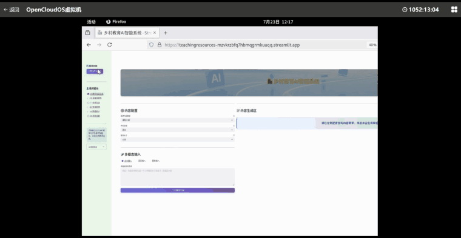
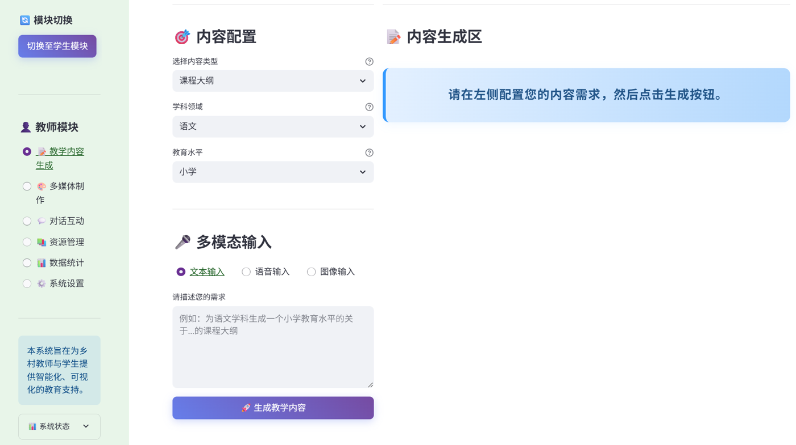
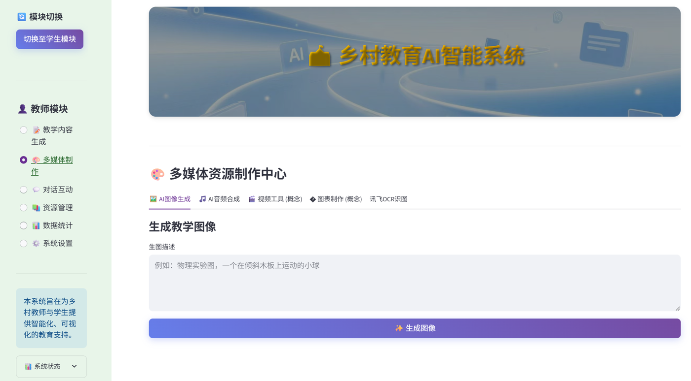
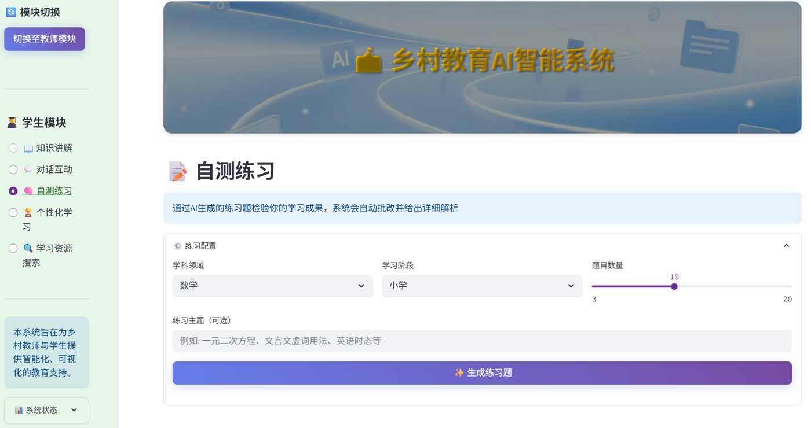
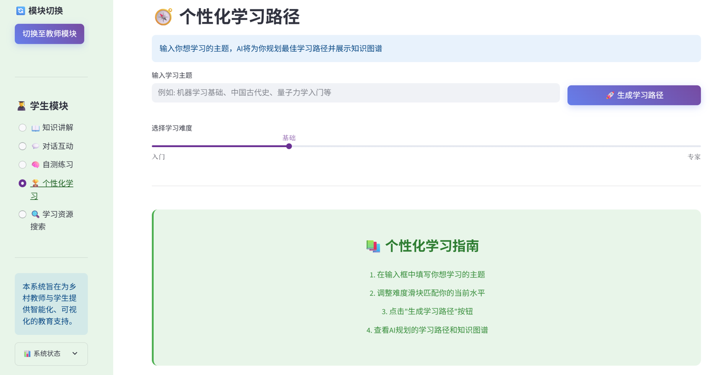
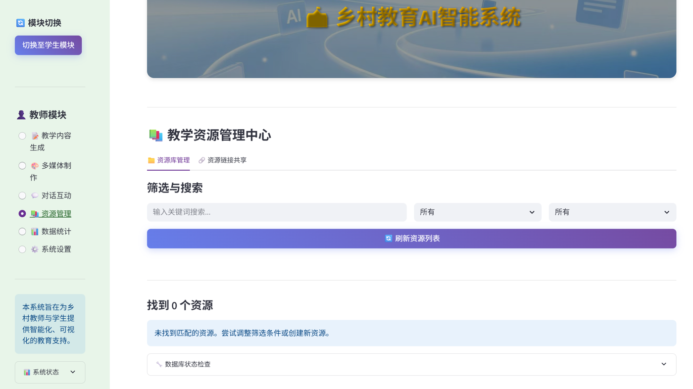
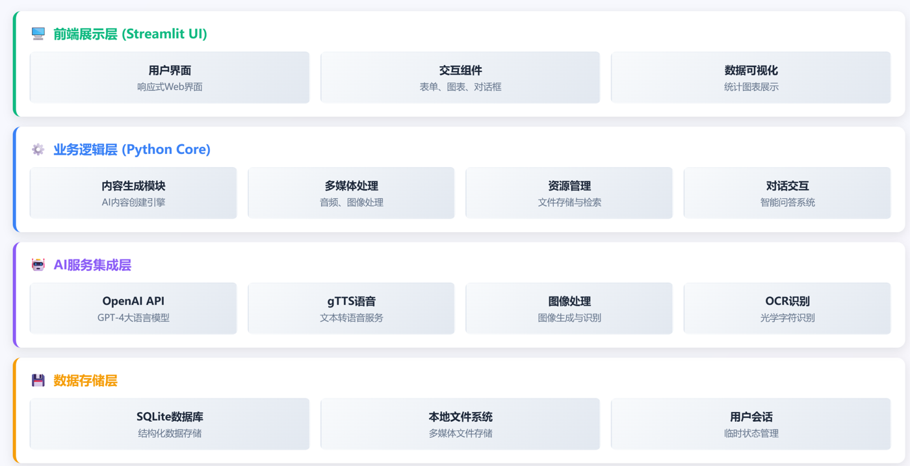

<div align="center">

# AI Teaching Resource Generator

[简体中文](README.md) | **English**

An AI teaching assistant for rural education. Teachers enter a topic and get a course outline, exercises, and multimedia materials. Students get explanations, self-tests, and a personalized learning path.


🏆 **National Third Prize, 14th China Software Cup**



</div>

---

## Demo Video

The animation above is a quick preview of the 5-minute walkthrough. The full video covers content generation, multimedia, and resource management on the teacher side, plus self-tests and learning paths on the student side.

https://github.com/yueyyer/ai-teaching-resource-generator/raw/main/docs/demo.mp4

<sub>If the video does not play inline, download [docs/demo.mp4](docs/demo.mp4).</sub>

## The Problem

Rural schools are often short of teachers. One teacher may cover several subjects and build lesson plans, quizzes, and slides from scratch. This app turns LLM capabilities into two workflows:

- **Teachers** pick a subject, grade level, and resource type, describe what they need, and get structured content. They can add AI illustrations and audio, export to PDF, and save it to a resource library.
- **Students** get explanations, self-tests, and a personalized learning path shown as a knowledge graph.

## Screenshots

<table>
  <tr>
    <td width="50%"><br><sub><b>Content generation</b>: choose type, subject, and level; text, voice, or image input</sub></td>
    <td width="50%"><br><sub><b>Multimedia</b>: AI illustrations, text-to-speech, image recognition</sub></td>
  </tr>
  <tr>
    <td width="50%"><br><sub><b>Self-test</b>: generate questions by subject, level, and count; get a score report</sub></td>
    <td width="50%"><br><sub><b>Personalized learning</b>: topic and difficulty in, learning path and knowledge graph out</sub></td>
  </tr>
  <tr>
    <td colspan="2"><br><sub><b>Resource library</b>: results saved in SQLite, with filtering, search, and link sharing</sub></td>
  </tr>
</table>

## Features

The app has a teacher module and a student module, switched from the sidebar.

### Teacher

| Feature | Description |
|---------|-------------|
| Content generation | Course outlines, slide content, exercises, case studies, lab guides; tailored by subject and level |
| Multimodal input | Text, uploaded audio (speech recognition), uploaded images (recognition) |
| Multimedia | iFlytek text-to-image, gTTS speech, image recognition |
| Resource library | SQLite storage: save, filter, search, delete, and share links |
| Statistics | Counts by resource type and subject, plus recent activity |
| Chat | LLM-powered teaching Q&A |

### Student

| Feature | Description |
|---------|-------------|
| Explanations | Student-facing explanations by subject and level |
| Chat | Q&A from a student's point of view |
| Self-test | Exercises by subject, level, and count, with a score report |
| Personalized learning | Staged learning path and knowledge graph from a topic and difficulty |
| Resource search | Search the local library, supplemented by Wikipedia |

## How It Works



- **Prompts and structured output**: each resource type has its own prompt template (`prompts/`) with subject, level, and request injected as parameters. The learning path asks the model for JSON (stages plus graph nodes and edges), which is parsed and then rendered.
- **Failure handling**: if parsing or an API call fails, the UI shows an error and falls back to an empty result instead of crashing.
- **Provider-agnostic**: LLM calls use the OpenAI-compatible protocol; switch providers with environment variables. Alibaba DashScope is the default.
- **Local persistence**: generated content and activity logs are stored in SQLite and reusable across sessions.

## Getting Started

### Requirements

- Python 3.11+
- An OpenAI-compatible LLM API key (e.g. Alibaba DashScope)
- Optional: iFlytek account (text-to-image), Tripo3D key (3D generation)

### Run locally

```bash
# 1. Clone
git clone https://github.com/yueyyer/ai-teaching-resource-generator.git
cd ai-teaching-resource-generator

# 2. Install
python -m venv venv
source venv/bin/activate   # Windows: venv\Scripts\activate
pip install -r requirements.txt

# 3. Configure keys
cp .env.example .env       # then fill in your own keys

# 4. Launch
streamlit run exercise.py
```

Open `http://localhost:8501`.

> No API keys are stored in this repository. Keys are read only from a local `.env`, which is git-ignored.

### Docker

```bash
docker build -t ai-teaching .
docker run -p 8501:8501 --env-file .env ai-teaching
```

## Project Structure

```plaintext
ai-teaching-resource-generator/
├── exercise.py            # Main entry: teacher / student modules
├── prompts/               # Prompt templates per resource type
├── word2picture.py        # iFlytek text-to-image client
├── picture1.py            # Image and 3D generation page
├── ocr_scenes_demo.py     # iFlytek scene recognition
├── 大模型中文语音识别.py      # iFlytek streaming speech recognition
├── sidebar_css.py         # Sidebar styles
├── .env.example           # Environment variable template
├── docs/                  # Demo video and screenshots
├── requirements.txt
├── Dockerfile
└── .streamlit/config.toml # Streamlit theme
```

> `app.py` is an early English prototype kept for reference. The current entry point is `exercise.py`.

## Tech Stack

- **UI**: Streamlit with custom CSS
- **LLM**: OpenAI SDK (compatible protocol), DashScope by default
- **Speech**: SpeechRecognition, gTTS, iFlytek speech recognition
- **Vision**: iFlytek text-to-image, DashScope image recognition, Pillow
- **Storage**: SQLite
- **Export and deployment**: FPDF for PDF; Docker

## Roadmap

- [ ] Export `.pptx` slides directly (currently generates outline content)
- [ ] Mistake notebook for exercises
- [ ] Multiple teacher accounts and class management
- [ ] Offline model support for schools with limited connectivity

## License

Released under the [MIT License](LICENSE).
