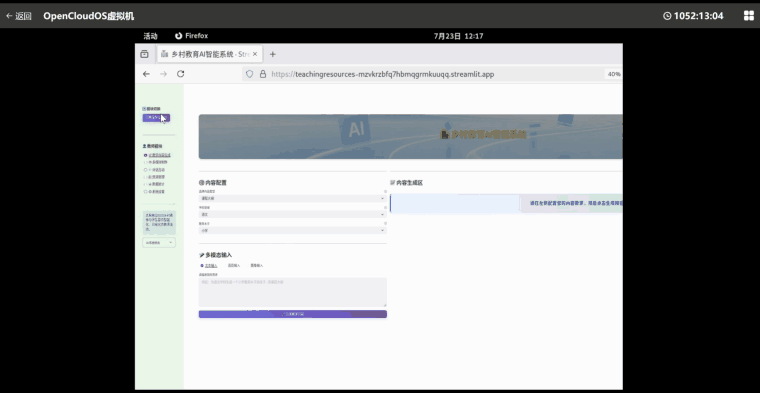
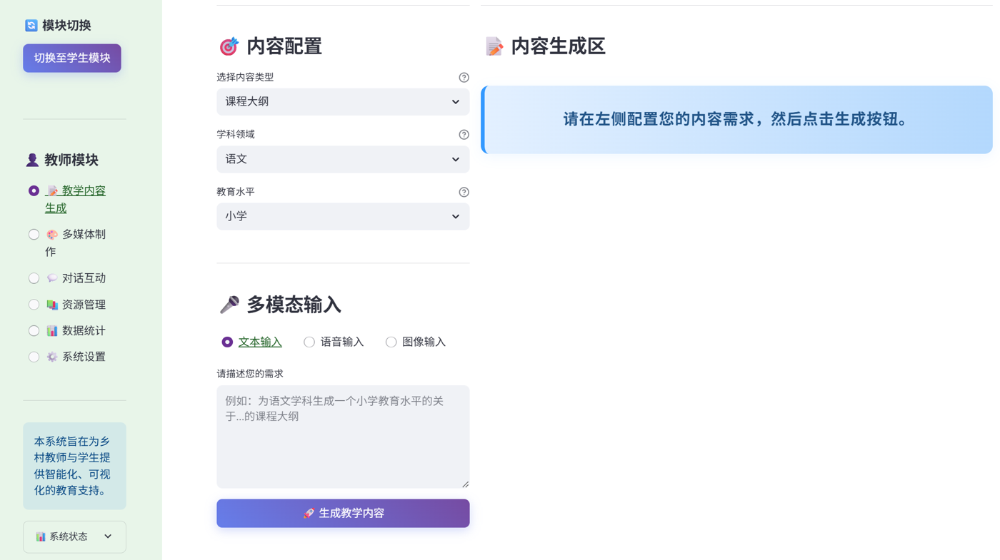
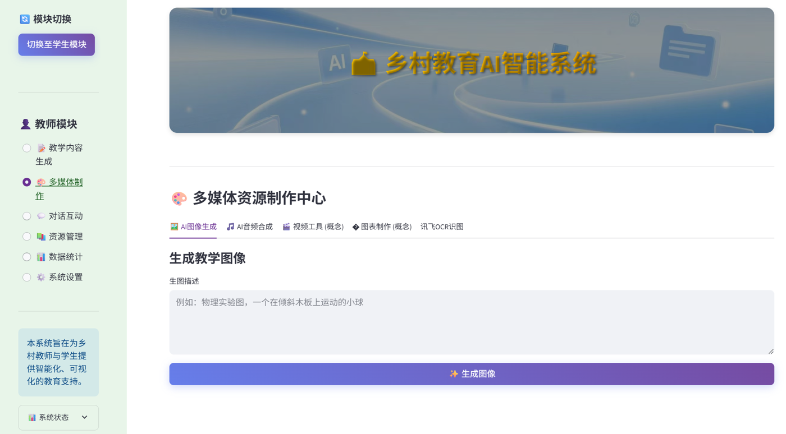
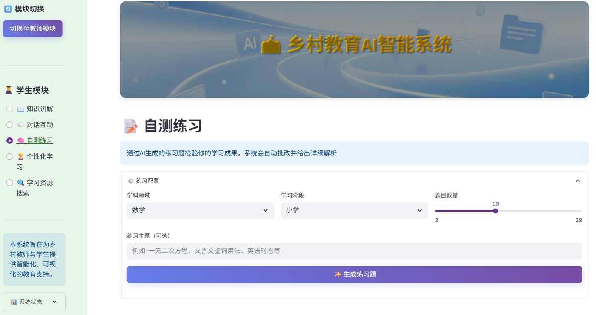
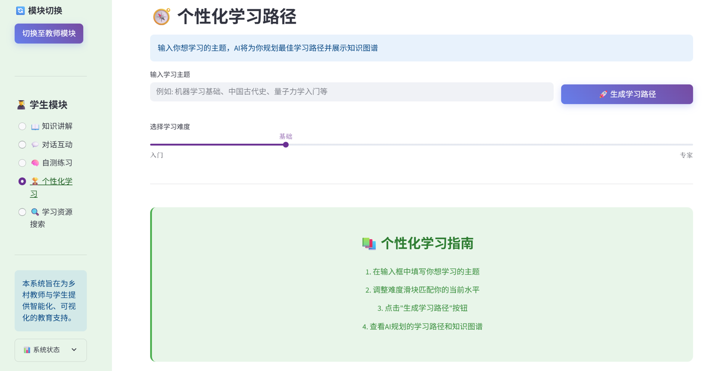
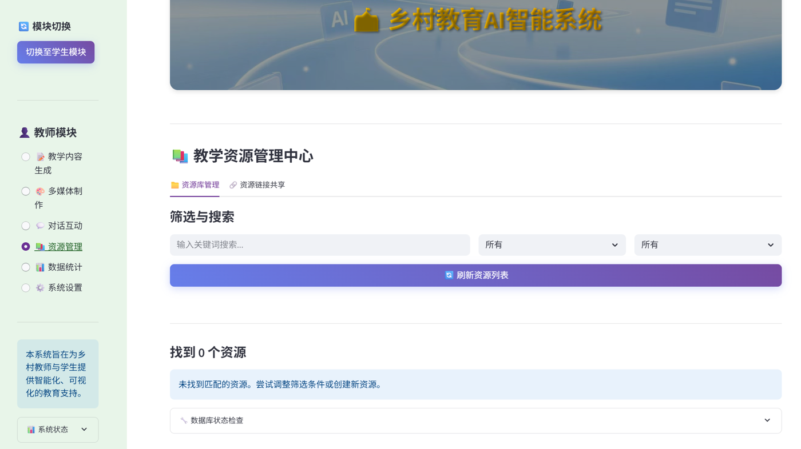
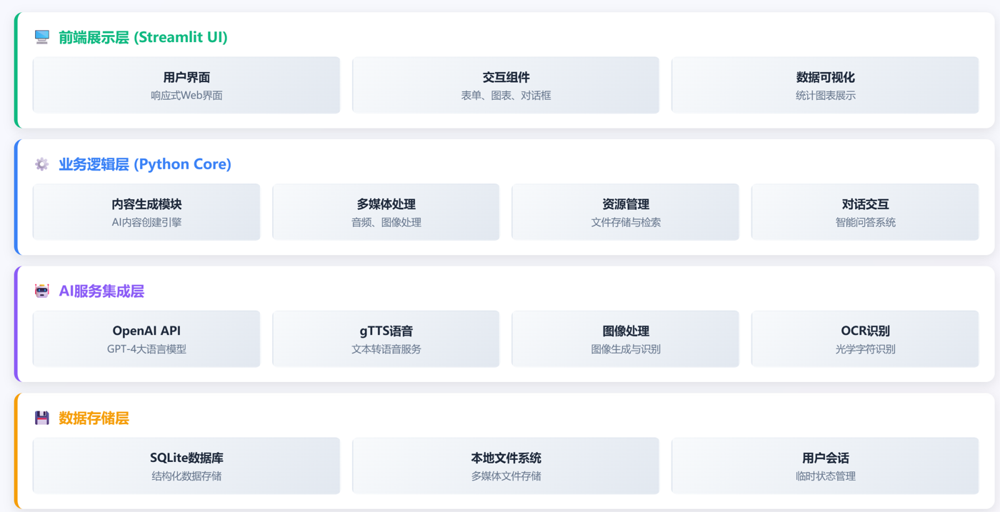

<div align="center">

# AI 智能教学资源生成系统

**简体中文** | [English](README.en.md)

面向乡村教育的 AI 教学辅助平台：教师输入一个主题，即可生成课程大纲、练习题和多媒体素材；学生可以获得知识讲解、自测练习和个性化学习路径。


🏆 **第十四届“中国软件杯”大学生软件设计大赛 · 国家级三等奖**



</div>

---

## 演示视频

上面的动图是 5 分钟完整演示的快速预览。完整视频覆盖教师端内容生成、多媒体制作、资源管理，以及学生端自测练习和个性化学习路径。

https://github.com/yueyyer/ai-teaching-resource-generator/raw/main/docs/demo.mp4

<sub>视频无法在线播放时，可直接下载 [docs/demo.mp4](docs/demo.mp4)。</sub>

## 解决什么问题

乡村学校常常师资紧张，一位老师要同时带多门课，教案、试题、课件基本都从零开始准备。这个系统把大模型能力整理成两条工作流：

- **教师端**：选择学科、学段和资源类型，输入需求，即可得到结构化的教学内容，并可配合 AI 插图、语音素材，导出 PDF 后存入资源库。
- **学生端**：提供知识讲解、自测练习，以及基于知识图谱的个性化学习路径。

## 功能截图

<table>
  <tr>
    <td width="50%"><br><sub><b>教学内容生成</b>：选择资源类型、学科和学段，支持文本、语音、图片三种输入</sub></td>
    <td width="50%"><br><sub><b>多媒体制作</b>：AI 生成教学插图、语音合成、图片识别</sub></td>
  </tr>
  <tr>
    <td width="50%"><br><sub><b>自测练习</b>：按学科、学段和数量出题，提交后给出成绩报告</sub></td>
    <td width="50%"><br><sub><b>个性化学习</b>：输入主题和难度，生成学习路径与知识图谱</sub></td>
  </tr>
  <tr>
    <td colspan="2"><br><sub><b>资源管理</b>：生成结果存入 SQLite，可筛选、搜索和共享链接</sub></td>
  </tr>
</table>

## 功能总览

系统分为教师和学生两个模块，在侧边栏切换。

### 教师模块

| 功能 | 说明 |
|------|------|
| 教学内容生成 | 课程大纲、教学 PPT、练习题、案例分析、实验指导等资源，可按学科与学段定制 |
| 多模态输入 | 支持文本输入、上传语音识别、上传图片识别 |
| 多媒体制作 | 讯飞文生图、gTTS 语音合成、图片识别 |
| 资源管理 | SQLite 资源库：保存、筛选、搜索、删除，并支持资源链接共享 |
| 数据统计 | 按资源类型、学科统计，并记录最近操作 |
| 对话互动 | 基于大模型的教学问答 |

### 学生模块

| 功能 | 说明 |
|------|------|
| 知识讲解 | 按学科和学段生成面向学生的讲解 |
| 对话互动 | 学生视角的问答 |
| 自测练习 | 按学科、学段和题量生成练习，提交后给出成绩报告 |
| 个性化学习 | 根据主题与难度生成分阶段学习路径和知识图谱 |
| 学习资源搜索 | 检索本地资源库，并结合 Wikipedia 补充 |

## 技术实现



- **提示词与结构化输出**：不同资源类型使用独立的提示模板（`prompts/`），学科、学段和需求以参数注入。学习路径要求模型直接返回 JSON（学习阶段 + 知识图谱的节点与边），解析后再渲染。
- **稳定性处理**：解析失败或接口异常时，在界面给出提示，并回退为空结果，不让页面崩溃。
- **多模型接入**：大模型调用走 OpenAI 兼容协议，通过环境变量切换服务商，默认对接阿里云 DashScope。
- **本地沉淀**：生成内容和操作日志写入 SQLite，跨会话可检索、可复用。

## 快速开始

### 准备

- Python 3.11+
- 一个 OpenAI 协议兼容的大模型 API Key（如阿里云百炼 DashScope）
- 可选：讯飞开放平台账号（文生图）、Tripo3D Key（3D 生成）

### 本地运行

```bash
# 1. 克隆仓库
git clone https://github.com/yueyyer/ai-teaching-resource-generator.git
cd ai-teaching-resource-generator

# 2. 安装依赖
python -m venv venv
source venv/bin/activate   # Windows: venv\Scripts\activate
pip install -r requirements.txt

# 3. 配置 API Key
cp .env.example .env       # 然后在 .env 中填入自己的 Key

# 4. 启动
streamlit run exercise.py
```

浏览器打开 `http://localhost:8501`。

> 仓库不包含任何 API Key。所有密钥只从本地 `.env` 读取，`.env` 已加入 `.gitignore`。

### Docker

```bash
docker build -t ai-teaching .
docker run -p 8501:8501 --env-file .env ai-teaching
```

## 项目结构

```plaintext
ai-teaching-resource-generator/
├── exercise.py            # 主入口：教师 / 学生双模块
├── prompts/               # 各类资源的提示词模板
├── word2picture.py        # 讯飞文生图接口封装
├── picture1.py            # 图像与 3D 生成工具页
├── ocr_scenes_demo.py     # 讯飞场景识别
├── 大模型中文语音识别.py      # 讯飞流式语音听写
├── sidebar_css.py         # 侧边栏样式
├── .env.example           # 环境变量模板
├── docs/                  # 演示视频与截图
├── requirements.txt
├── Dockerfile
└── .streamlit/config.toml # Streamlit 主题
```

> `app.py` 是早期的英文课程内容生成原型，保留作参考；当前入口是 `exercise.py`。

## 技术栈

- **界面**：Streamlit + 自定义 CSS
- **大模型**：OpenAI SDK（兼容协议），默认 DashScope
- **语音**：SpeechRecognition、gTTS、讯飞语音听写
- **图像**：讯飞文生图、DashScope 图片识别、Pillow
- **存储**：SQLite
- **导出与部署**：FPDF 生成 PDF；Docker

## 后续计划

- [ ] 直接导出 `.pptx` 课件（目前生成的是大纲内容）
- [ ] 练习题错题本
- [ ] 多教师账号与班级管理
- [ ] 离线模型支持，适配网络条件有限的学校

## License

基于 [MIT License](LICENSE) 开源。
